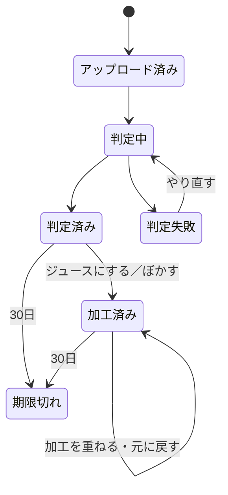

# 隠酒（インシュ） 基本設計（作成中）

## 1. 位置づけ
要件定義（`inshu.md`）の要求 1〜11 を満たすための機能・画面・流れを決める。

## 2. 機能一覧（案）
| ID | 機能 | 概要 | 主な利用者 | 要求 |
|---|---|---|---|---|
| F-01 | Slack ログイン | 良良タイムズと同じ Slack アプリで認証。広報担当に登録された人だけ使える | 広報担当 | - |
| F-02 | 広報担当の管理 | 広報担当・広報責任者の登録と解除 | 広報責任者 | - |
| F-03 | 写真のアップロード | 1回に20枚まで。端末で長辺を縮小し、位置情報（EXIF）を消してから送る | 広報担当 | 1 |
| F-04 | 広報NGの判定 | Gemini に写真と基準（NG 項目と説明）を渡し、写り込みごとに項目・枠・理由・確からしさを返させる | システム | 2, 10 |
| F-05 | 炎上リスクの点数 | NG 項目ごとの重みと確からしさから 0〜100 点を出す。一覧をリスクの高い順に並べる | システム | 3 |
| F-06 | お酒の置き換え | お酒の写り込みを、選んだジュース（オレンジ・リンゴ・ぶどう・ラムネ・麦茶など）に Gemini で置き換える | 広報担当 | 4 |
| F-07 | ぼかし | お酒以外の NG の枠をぼかす。ブラウザで加工して保存する | 広報担当 | 5 |
| F-08 | 枠の手直し | 判定の枠を消す・足す（見落としや誤検出を人が直す） | 広報担当 | 2, 11 |
| F-09 | ビフォーアフター | 加工前と加工後をスライダーで見比べる | 広報担当 | 6 |
| F-10 | ダウンロード | 加工後の画像を1枚ずつ、またはまとめて（zip）保存する | 広報担当 | 7 |
| F-11 | ギャラリー | 加工後の画像を広報担当の全員が見られる。元画像は処理した本人だけが見られる | 広報担当 | 8 |
| F-12 | 基準の編集 | NG 項目（名前・説明・重み・扱い＝置き換え／ぼかし／警告のみ）を追加・編集・無効化する | 広報責任者 | 10 |
| F-13 | 自動削除 | アップロードから30日で元画像・加工後・判定結果を消す | システム | 9 |
| F-14 | 注意書き | 判定は補助で最終判断は人、の注意を判定結果の画面に常に出す | 広報担当 | 11 |

## 3. 画面一覧（案）
| ID | 画面 | 利用者 | 主な要素 |
|---|---|---|---|
| S-01 | ログイン | 広報担当 | 「Slack でログイン」、隠酒のロゴ（お酒がジュースに化ける演出） |
| S-02 | チェック（アップロード） | 広報担当 | 写真を選ぶ／ドラッグ（20枚まで）、送信、注意書き（写真は AI に送られる） |
| S-03 | 判定結果の一覧 | 広報担当 | 進み具合、写真ごとのサムネイル・炎上リスク点数・NG 項目のバッジ、リスク順の並び、「まとめてダウンロード」 |
| S-04 | 写真の詳細 | 広報担当 | 写真と NG の枠、項目ごとの理由、ジュースの種類を選んで「ジュースにする」、「ぼかす」、枠の手直し、ビフォーアフター、ダウンロード、注意書き |
| S-05 | ギャラリー | 広報担当 | 全員の加工後の画像（新しい順）。自分の作品には元画像も表示。残り日数 |
| S-06 | 基準の編集 | 広報責任者 | NG 項目の一覧と編集（名前・説明・重み・扱い・有効） |
| S-07 | 広報担当の管理 | 広報責任者 | Slack のメンバーから追加・解除、責任者の付け外し |

## 4. 状態の流れ（写真）

## 5. 設計方針（案）
- 判定と置き換えは Worker から Gemini を呼ぶ（待ち時間は CPU 時間に数えられないため Worker で足りる）。1枚ずつ順番に処理し、S-03 で進み具合を見せる
- ぼかしはブラウザ（canvas）で行い、結果を R2 に保存する（Worker の CPU を使わない）
- 判定の指示には、基準（S-06 の NG 項目）をそのまま入れる。基準を変えると以後の判定に反映される
- 置き換えは「お酒の部分だけを、同じ形・同じ光の当たり方のジュースに変える」よう指示し、人の顔や他の部分は変えない
- 写真は判定の前に、端末で長辺 2048px に縮小し、EXIF を消す

## 6. 決定（11/16）
- ジュース：定番（オレンジ・リンゴ・ぶどう・ラムネ・麦茶・おまかせ）から選ぶか、自由入力（20字まで）。自由入力は飲み物以外を指定できないよう、判定の指示で「飲み物でなければ置き換えない」とする
- 置き換えの上限：1人1日100回（暫定、設定値）。超えたらぼかしで対応してもらう
- ネタ演出：変身アニメーション（置き換えの瞬間に「ポンッ」と煙が出てジュースになる）、炎上メーター（リスク点数を炎のメーターで表示し、加工後に鎮火する）
